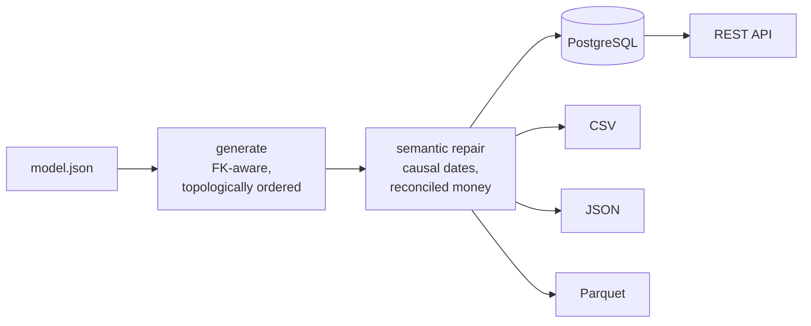

# Declarative Synthetic Data Pipeline

**Generating referentially-consistent synthetic datasets at arbitrary scale,
across heterogeneous storage systems.**

A Big Data Analytics (semester 7) project. Describe a domain once as JSON —
tables, fields, types, relationships, volumes — and the pipeline produces a
complete synthetic dataset and materialises it simultaneously into PostgreSQL,
CSV, JSON, Parquet and a live REST API, with foreign keys that remain valid
*across* all of them.

> A short product name is still to be chosen; `SynthForge` is the current
> proposal. Nothing depends on it — it is a find-replace over three files.

---

## Why this exists

Everything worth knowing in data engineering only becomes visible at scale. A
query plan at ten thousand rows and the same plan at ten million are different
plans. Indexes that look pointless become load-bearing. Join order starts to
matter, and so do cardinality skew, cache residency and the cost of a network
round trip.

The data that exhibits scale is held by organisations that will not release it.
Amazon has the order graph; a bank has the full ledger. They publish papers
*about* their scale, not the data behind it — it is simultaneously their
competitive advantage, their regulatory liability and their customers' private
information. What is publicly available is small, single-table, or stripped of
exactly the relational structure that makes a dataset worth studying.

So the ability to *learn and practise* at scale is gated by employment. People
inside those organisations get better at operating at scale because they can
practise; everyone else practises on a 500-row CSV and finds out what a
ten-million-row join costs in production.

This project removes the gate by making volume a parameter rather than a
property of a dataset you were handed. `--scale 1` gives 100,400 rows;
`--scale 50` gives five million from the same model. That lets you study the
*curve* instead of a single point, which is the one thing no public dataset can
offer.

Full argument: **[docs/why-synthetic-data.md](docs/why-synthetic-data.md)**.

### Interactive site

A small static site with its own pages: an overview, a live run console, a model
builder, the measurements, an API reference and the docs.

- **[`site/index.html`](site/index.html)** — open it in any browser. No server,
  no build step, no network needed. Print or save to PDF for a paper copy.
- **`python serve_demo.py`** — serves the same site *and* gives the Live run
  page a button that executes the real Python pipeline, streaming its stages and
  logs back to the browser over Server-Sent Events.
- **[Hosted copy](https://claude.ai/artifact/A5qaitR6DSeKCsjbD9V4ro)** — for
  sharing by link. Requires a Claude account, and is replay-only.

---

## What it does



Three claims, each of which the project actually supports:

**Declarative.** A new domain is a JSON file, not a code change. Field *names*
drive both the generated values and the inferred relationships, so a model that
names a column `cost` and another `price` gets a sane margin for free.

**Referentially consistent across heterogeneous sinks.** A `user_id` in a CSV
row resolves to a real row in PostgreSQL, because every destination is
materialised from one in-memory dataset rather than generated per sink. Foreign
keys are added *after* the bulk load, so PostgreSQL itself validates every
generated reference in one pass and names the offending row if any fails. The
claim is proven, not asserted.

**Measured.** The pipeline reports its own throughput, round-trip counts and
byte volumes to `runs/run_report.json`. Round trips are counted by an
instrumented cursor, not estimated.

---

## Results

All figures produced by harnesses committed in `runs/headline/`, run uncontended
and repeated. Method in **[docs/performance.md](docs/performance.md)**.

### Generation throughput, full scale (100,400 records)

The foreign-key lookup rebuilt its entire candidate list on every field call —
roughly 2.0 billion dictionary probes per run — for a result that is invariant
per `(table, field)`. Memoizing it is byte-identical output, verified across all
six tables and all 49 fields.

| table | rows | before | after | speedup |
|---|---|---|---|---|
| `order_items` | 40,000 | 62.93s | 0.41s | **151.6x** |
| `reviews` | 15,000 | 24.24s | 1.74s | 13.9x |
| `orders` | 15,000 | 8.30s | 2.09s | 4.0x |
| `products` | 20,000 | 3.08s | 2.65s | 1.2x |
| `users` | 10,000 | 2.62s | 2.60s | 1.0x |
| `categories` | 400 | 0.07s | 0.05s | 1.4x |
| **total** | **100,400** | **101.24s** | **10.06s** | **10.1x** |

The speedup tracks rows x parent-rows, and the three tables with no meaningful
foreign-key load are flat — the signature of the right fix rather than a lucky
one.

### Data realism, full scale

Structural validity is easy and not very useful. A dataset where every user is
an infant and no order total matches its line items teaches you nothing about a
real query plan, because no real plan ever sees data shaped like that.

| metric | before | after |
|---|---|---|
| `users.birth_date` implied age | 0.0–2.0 years | 18.0–79.99 years |
| users under 18 | 10,000 / 10,000 | 0 / 10,000 |
| orders placed before the user registered | 49.8% (7,467) | 0% |
| reviews written before the product existed | 49.9% (7,479) | 0% |
| line totals != qty x price − discount | 100% (40,000) | 0% |
| order totals != sum of line items | 100% (13,969) | 0% |
| `users.total_spent` != order history | 100% (10,000) | 0% |
| `unit_price` unrelated to the product's price | 58.4% (23,368) | 0% |
| products priced at or below cost | 50.0% (9,992) | 0% |
| category names using the `_N` fallback | ~370 / 400 | 0 / 400 |
| distinct product names | 30 / 20,000 | 20,000 / 20,000 |

Every repair rule is driven by field names and the foreign-key graph, never by
hardcoded table names — which is what keeps the declarative claim intact.

### Load path

The dominant cost of a run. Measured against a Supabase PostgreSQL 17.11
instance in eu-west-1 with a **285 ms** median round-trip time, where a
row-at-a-time load of 85,400 rows would spend hours purely waiting.

See **[docs/performance.md](docs/performance.md#load-strategies)** for the
strategy comparison, the round-trip counts and the projection method.

---

## Quick start

On Windows, one entry point does everything:

```bat
run.bat                preflight, pipeline at 5%, API server, website
run.bat full           the same, at full scale (100,400 records)
run.bat site           website only
run.bat api            API server only
run.bat pipeline 0.01  pipeline only, at any scale
run.bat offline        everything with no database at all
run.bat test           the test suite
run.bat clean          drop the model's tables from the database
run.bat check          preflight only
run.bat install        install dependencies
```

`site`, `offline`, `test` and `check` work without a database.


```bash
git clone https://github.com/Vatsal-Patel-09/data-pipeline-automation.git
cd data-pipeline-automation
pip install -r requirements.txt
cp example.env .env        # then fill in your database credentials
```

Nothing below needs a database except `run` and `export-db`:

```bash
# Check a model against the contract
python data_pipeline.py validate

# Print the execution plan: order, closure, row counts. Sub-second.
python data_pipeline.py --dry-run

# Everything except the network: renders DDL and COPY payloads to exports/
python data_pipeline.py --offline

# Serve the generated data with no database at all
python api_server.py --offline

# The test suite (db-marked tests skip automatically)
python -m pytest
```

With a database:

```bash
# Full pipeline, then verify
python data_pipeline.py run --verify-writes

# Fast iteration at 1% volume
python data_pipeline.py run --scale 0.01

# Compare load strategies
python data_pipeline.py run --load-strategy rowwise
python data_pipeline.py run --load-strategy execute_values --page-size 1000
python data_pipeline.py run --load-strategy copy      # default

# Restorable SQL dump, pure Python, no pg_dump needed
python data_pipeline.py export-db --output exports/database_dump.sql

# API server, interactive docs at /docs
python api_server.py --port 8000
```

### Database connection note

Supabase's direct host `db.<ref>.supabase.co` publishes **only an AAAA record**,
so it requires IPv6. On a network without an IPv6 route, use the Supavisor
session pooler on **port 5432** — not 6543, which is transaction mode and does
not persist session-level `SET`, making `COPY` unreliable and any session-tuning
measurement meaningless. The pipeline diagnoses this at the point of failure
rather than reporting a bare name-resolution error.

---

## The data model

```json
{
  "database": { "name": "ecommerce_platform", "version": "1.0" },
  "tables": [
    {
      "name": "orders",
      "sample_size": 15000,
      "output_format": "api",
      "fields": [
        { "name": "id", "type": "integer", "primary_key": true, "auto_increment": true },
        { "name": "user_id", "type": "integer", "foreign_key": "users.id" },
        { "name": "total_amount", "type": "decimal", "precision": 12, "scale": 2 },
        { "name": "status", "type": "enum", "values": ["pending", "shipped", "delivered"] }
      ]
    }
  ]
}
```

The shipped model, `ecommerce_model.json` — 6 tables, 49 fields, 100,400 rows:

| table | rows | declared destination | also in PostgreSQL |
|---|---|---|---|
| `categories` | 400 | postgres | — |
| `users` | 10,000 | csv | yes |
| `products` | 20,000 | json | yes |
| `orders` | 15,000 | api | yes |
| `order_items` | 40,000 | postgres | — |
| `reviews` | 15,000 | csv | no (leaf) |

`users` and `products` land in **two** places each: their declared file sink,
*and* PostgreSQL, because `orders` and `order_items` reference them. That dual
destination is where the integrity claim is actually tested. 85,400 of the
100,400 rows reach the database.

Row counts come from `sample_size` in the model. Change them there, not here.

Full contract: **[docs/data-model.md](docs/data-model.md)**.

---

## API

| Method | Path | Description |
|---|---|---|
| GET | `/` | API metadata and available endpoints |
| GET | `/health` | Liveness, with a real timestamp |
| GET | `/orders` | Paginated orders; filter by `status`, `user_id`; `skip`/`limit` or `after_id` |
| GET | `/orders/{id}` | One order, or 404 |
| GET | `/orders/stats/summary` | Aggregates and status breakdown |
| GET | `/docs` | Interactive OpenAPI documentation |

```bash
curl "http://localhost:8000/orders?status=shipped&limit=5"
curl "http://localhost:8000/orders/42"
curl "http://localhost:8000/orders/stats/summary"
```

`status` is validated against the model's enum, so a typo returns **422** rather
than an empty 200. `after_id` gives keyset pagination, which does not pay
`OFFSET`'s increasing cost on deep pages.

---

## Project layout

```
data_pipeline.py          CLI entrypoint and orchestrator
api_server.py             FastAPI app, repository-backed, offline-capable
ecommerce_model.json      The model that drives everything
site/                     Static site: overview, live run, builder, benchmarks
serve_demo.py             Serves the site and runs the real pipeline behind it

src/
  model_graph.py          THE model loader: validate, order, closure, waves
  data_generator.py       Record generation, field-name driven
  realism.py              Post-generation semantic repair
  output_handlers.py      Routing and writing to five destinations
  load_strategies.py      rowwise | execute_values | copy
  serialization.py        Per-sink value conversion, in one place
  database_manager.py     DDL synthesis, constraint deferral, verification
  db.py                   Connection config, instrumented cursor, diagnosis
  metrics.py              Spans, per-table metrics, run report

tests/                    165 tests: 149 offline, 16 db-marked
runs/headline/            Committed benchmark evidence and its harnesses
docs/                     See below
exports/                  Generated output (gitignored)
```

---

## Documentation

| Document | Contents |
|---|---|
| [`site/`](site/index.html) | Interactive site: live run, model builder, benchmarks, API |
| [why-synthetic-data.md](docs/why-synthetic-data.md) | The thesis: why this project exists |
| [performance.md](docs/performance.md) | Every measurement, with method |
| [architecture.md](docs/architecture.md) | How a run flows through the system |
| [data-model.md](docs/data-model.md) | The model-JSON contract, and how to extend it |
| [known-issues.md](docs/known-issues.md) | What is fixed, open, and deliberately declined |
| [branches.md](docs/branches.md) | `master` is not the whole project |

---

## Testing

```bash
python -m pytest           # 149 offline tests
python -m pytest -m db     # 16 more, against a live database
```

The most important test is `test_every_foreign_key_resolves_to_a_real_parent`,
which converts the project's central claim from prose into a checked invariant.
Its integration counterpart does the same from the other direction: it takes
foreign keys out of a CSV file and resolves them against rows in PostgreSQL.

The suite also pins the *before* state of several defects, so the comparison
tables above stay checked rather than remembered.

---

## Honest limitations

Read **[docs/known-issues.md](docs/known-issues.md)** before relying on
anything. In brief:

- The API serves only `orders`; response models are hand-written, so a second
  `api` table is loaded but not exposed.
- `--parallel-loads` is implemented but unmeasured. The expectation is that it
  is roughly flat, because once rows are batched the work is bandwidth-bound.
- The vectorized and GPU generation engines are **not built**. The honest
  expectation, recorded before building: a GPU path is *slower* at this scale,
  because initialising the CUDA context costs more than the entire CPU cost of
  every numeric column, and the real remaining cost is string work a GPU cannot
  touch.
- There is no CI.
- This is a coursework demonstrator, not a production ELT tool. Correctness,
  measurement and clarity were the goals; multi-node horizontal scale was not.

---

## Built with

Python 3.13 · PostgreSQL 17 (Supabase) · psycopg2 · Faker · pandas · PyArrow ·
NumPy · FastAPI · uvicorn · Pydantic · Click · pytest
