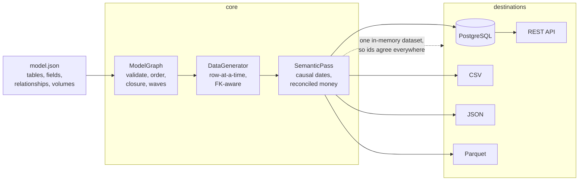
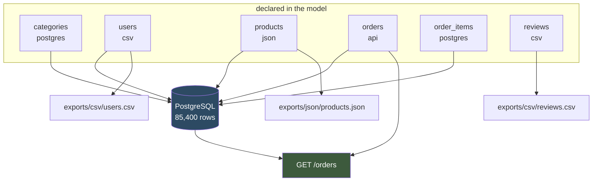
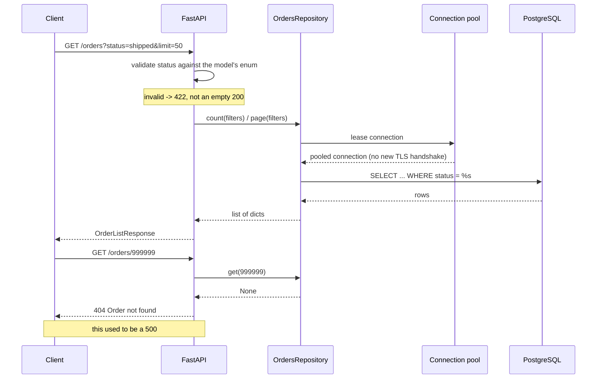
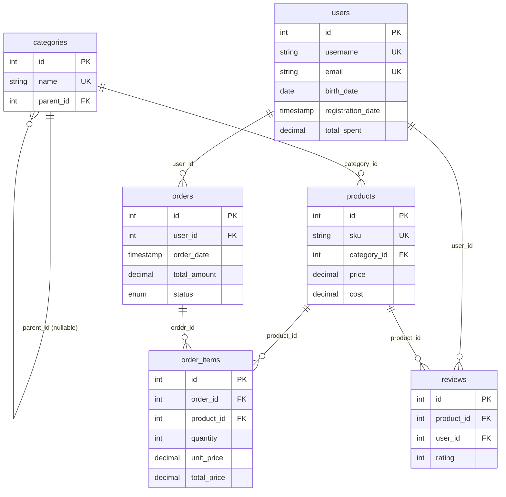
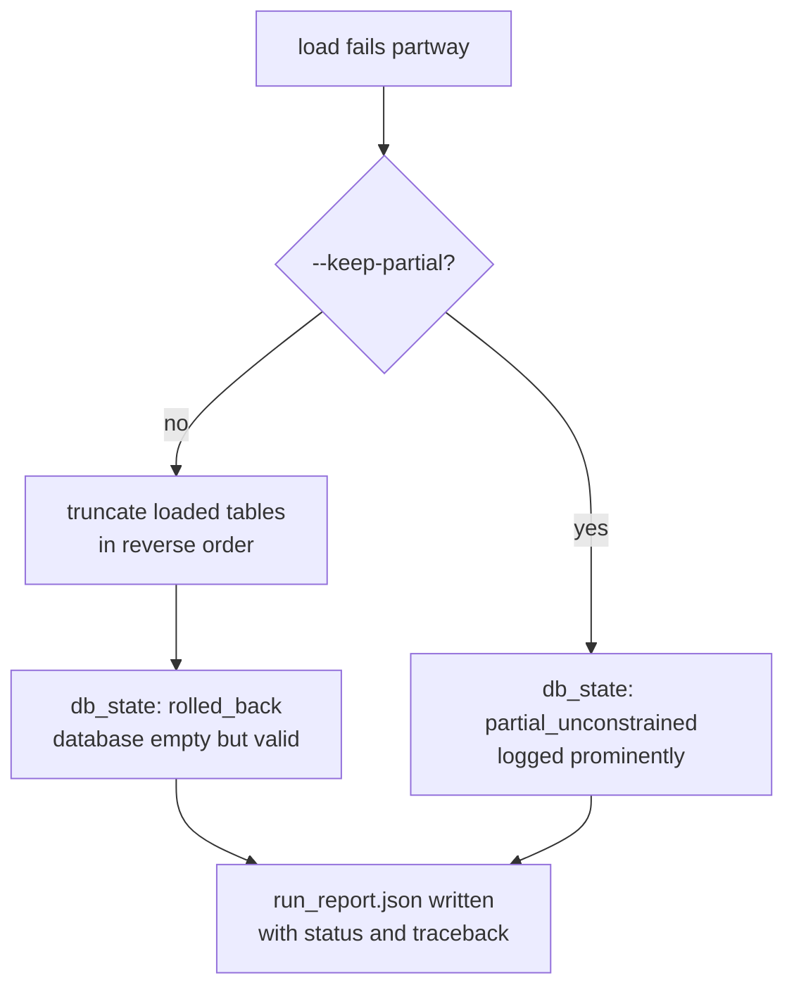

# Architecture

## The shape of a run



Five steps, each a timed span in the run report:

| Step | What happens | Entry point |
|---|---|---|
| `schema` | DDL for every table, in one round trip. Foreign keys deferred by default. | `DatabaseManager.create_schema` |
| `generate` | Records per table in topological order, then the semantic repair pass | `DataGenerator.generate_all_data` |
| `output` | Phase 1 loads PostgreSQL-backed tables; phase 2 writes the file sinks | `OutputHandler.process_all_outputs` |
| `finalize` | Add foreign keys, advance sequences, verify row counts, optional write probe | `DataPipeline._finalize` |
| `report` | Human-readable summary; `run_report.json` written | `DataPipeline.generate_summary_report` |

## The one thing that matters most

**Cross-destination referential integrity comes from fanning out a single
in-memory dataset.** There is no second generation pass per sink.

`DataGenerator.generated_data` holds every record. A foreign key is resolved by
drawing from the parent table's already-generated primary keys, which exist
because tables are generated in topological order. The id a CSV row carries is
therefore byte-identical to the id the PostgreSQL parent row carries — not
because anything reconciles them afterwards, but because there is only ever one
value.

Two mechanisms protect the property:

- **The dual-destination closure.** A table declared `csv` still gets loaded
  into PostgreSQL if any PostgreSQL-backed table references it, because
  otherwise the child's foreign key would have no parent row. Computed by
  `ModelGraph.postgres_closure`, transitively.
- **Server-side validation.** Foreign keys are added *after* the bulk load, so
  PostgreSQL validates every generated reference in one sequential pass. If
  generation were wrong the constraint is refused and the offending row named.
  The claim is proven rather than asserted.

For the shipped model the closure is `{categories, users, products, orders,
order_items}` — five of six tables. `reviews` is a leaf that nothing references,
so it is created in the schema but only ever written to CSV.

## Destination routing



`users` and `products` land in two places each: their declared file sink, and
PostgreSQL because `orders` and `order_items` reference them. That dual
destination is the whole point — it is where the integrity claim is actually
tested.

## Module responsibilities

```
data_pipeline.py        CLI, orchestration, spans, run report, SQL export
api_server.py           FastAPI app, repository abstraction, offline serving

src/model_graph.py      THE model loader. Validation, topological order,
                        transitive closure, parallel waves, cycle detection.
                        Model-driven, not data-driven, which is what makes
                        --dry-run possible.

src/data_generator.py   Record generation. Field values inferred from field
                        names. Memoized parent-id lists for FK resolution.

src/realism.py          Post-generation semantic repair. Cross-table, so it
                        must run after every table exists.

src/output_handlers.py  Routing and writing. Phase 1 PostgreSQL, phase 2 files.

src/load_strategies.py  rowwise | execute_values | copy, behind one interface.

src/serialization.py    Per-sink value conversion, in one place so the sinks
                        cannot drift.

src/database_manager.py DDL synthesis, constraint deferral, sequence repair,
                        verification, write probe.

src/db.py               Connection config (one resolver), InstrumentedCursor,
                        host diagnosis, RTT probe.

src/metrics.py          Spans, per-table metrics, run_report.json.
```

### Why `model_graph` exists

The same topological sort was previously implemented three times, and the copies
had diverged:

| Location | Deterministic? | Transitive closure? | Shorthand FK? | Cycle reported? |
|---|---|---|---|---|
| `database_manager` | no — unsorted set | n/a | yes | silently |
| `data_generator` | yes | n/a | yes | warned |
| `output_handlers` | yes | **no** | **no** | warned |

Every row of that table was a defect. Consolidating fixed all of them at once,
and the non-transitive closure plus the ignored shorthand were a *latent hard
failure*: together they produce a real foreign-key constraint, with valid
values, whose parent table was never loaded.

## Request path for the API



The repository abstraction has two implementations. `PostgresOrdersRepository`
leases from a `ThreadedConnectionPool`. `JsonFileOrdersRepository` reads
`exports/api/orders.json`, which is what lets the API run with no database at
all — useful for a demo, and the reason the endpoints are unit-testable.

## Entity relationships in the shipped model



Generation order, derived and deterministic:
`categories → users → orders → products → order_items → reviews`

`categories.parent_id` is self-referencing and excluded from the ordering
constraint — a table cannot be created after itself. It is also constrained to
reference only *earlier* rows, which makes a cycle in the hierarchy structurally
impossible rather than incidentally absent.

## Failure behaviour

Deferring constraints introduces a failure mode the original did not have: a
load that fails partway leaves populated, unconstrained, unsequenced tables — a
database that looks loaded and guarantees nothing. So:



The invariant is that the database is either *fully loaded and constrained*, or
*empty*. `run_report.json` is written in a `finally`, including on failure —
previously an exception was swallowed into a `False` return, so the run you most
want evidence from produced none.

## What the run report carries

Shaped for a dashboard to consume directly: flat arrays of uniform records,
every duration suffixed `_s`, every rate `_per_s`.

```
schema_version, run_id, status, db_state, duration_s
config        engine, seed, scale, model_hash, load_strategy, page_size,
              defer_constraints, offline, session_tuning{applied, rejected}
environment   python, platform, cpu, cores, library versions,
              db_host_kind, db_rtt_ms, peak_rss_mb
steps[]       name, duration_s, status
tables[]      table, rows, fields, destinations[], generate_s,
              load{strategy, duration_s, roundtrips, bytes_sent, simulated}
              files[]{sink, path, bytes, duration_s}
totals        rows_generated, rows_loaded, roundtrips_db, bytes_sent_db, ...
verification  fk_constraints_added, fk_violations, row_counts_match,
              sequences_advanced, write_probe, realism{...}
graph         topological_order, postgres_closure, waves, cycles, foreign_keys
```

`roundtrips_db` is counted by `InstrumentedCursor`, not estimated. That is what
makes the before/after comparison in [performance.md](performance.md) credible
rather than asserted.
